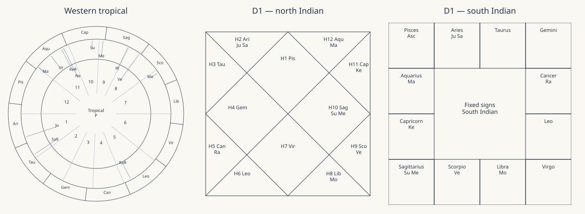

# Hermes Astrology

A Hermes skill and local calculator for Western astrology and Jyotisha.

Hermes Astrology is an early-stage, open-source tool for Western astrology and Jyotisha. It combines local chart calculations and visual reports with AI-assisted interpretation. The project is documented and usable, but it’s new and has not yet attracted visible community engagement. Feedback, testing, and contributions are welcome.
The calculator produces chart data, diagrams, planetary periods and transit tables. Hermes uses the included references to write a reading from those results. Western and Jyotisha calculations remain separate throughout the report.



## Features

| Area | Supported calculations |
| --- | --- |
| Western natal | Tropical positions, Ascendant, Midheaven, houses and five major aspects |
| House systems | Placidus, whole sign, equal, Koch and Porphyry |
| Jyotisha | Sidereal positions, whole-sign Rashi houses and Parashari sign-based graha drishti |
| Ayanamsha | Lahiri, Raman and Krishnamurti |
| Divisional charts | D9 Navamsha and D10 Dashamsha using the stated Parashari rules |
| Lunar data | Moon nakshatra, pada and tithi at the birth instant |
| Periods | Vimshottari birth balance, mahadashas and antardashas |
| Timing | Western transit aspects; Jyotisha gochara houses and graha drishti |
| Data checks | Historical timezones, repeated/nonexistent local times and birth-time uncertainty endpoints |
| Output | JSON, a standalone HTML chart atlas and a Markdown calculation record |

Calculations run locally through PySwissEph with the Moshier analytical ephemeris. No astrology API key or external ephemeris download is needed. Hermes's language-model provider is configured separately.

## Requirements

- Python 3.11 or newer.
- Hermes for assisted readings. The calculator also works by itself.
- Internet access for the initial dependency installation. Calculations work offline afterward.

## Install as a Hermes skill

Clone or extract this repository into an `astrology-structured` folder inside the active Hermes profile's `skills` directory. Keep `SKILL.md` at that folder's root. Use `HERMES_HOME` if configured; otherwise use the profile directory reported by your Hermes installation.

From that folder, create a local Python environment.

**Windows PowerShell**

```powershell
./scripts/setup.ps1
./.venv/Scripts/python.exe scripts/self_check.py
```

**Linux or macOS**

```sh
sh scripts/setup.sh
./.venv/bin/python scripts/self_check.py
```

Start a new Hermes chat so its skill catalog is refreshed. Say:

> Use astrology-structured to calculate and read my Western and Jyotisha charts. Ask for missing birth details, show the chart settings, generate the supported diagrams and tables, and explain each conclusion from its placements. Save the report locally.

Automatic selection depends on Hermes and the model. Naming the skill explicitly is the fallback.

## Run the calculator

With the environment activated, install the command-line entry point:

```sh
python -m pip install .
hermes-astrology --input assets/request.example.json --out reports/demo
```

You can also run the script directly without installing the project:

```sh
python scripts/chart_engine.py --input assets/request.example.json --out reports/demo
```

Open `reports/demo/charts.html` in a browser. Choose a new output directory for each run; the calculator refuses to overwrite report files.

The [example request](assets/request.example.json) is fictional. For a personal reading, keep your request in the ignored `private/` directory. See [input settings](docs/input.md) for the fields and conventions.

## Reports

| File | Contents |
| --- | --- |
| `chart.json` | Positions, settings, periods, transits, uncertainty checks and provenance |
| `charts.html` | Western wheel; north and south Indian D1/D9/D10 charts; tables |
| `calculation.md` | Engine settings, internal checks and calculation warnings |
| `reading.md` | Written by Hermes using the skill's report instructions |
| `study-note.md` | Optional learning progress saved at the user's request |
| Fortune Report (Fortune Report mode) | Branded HTML + PDF, Index 01–16, Lucky Things, numerology, Lo Shu Grid, career, month-wise, Kundali, Life-Path — `scripts/fortune_report.py --lang en|hi|hinglish|mr|or` |
| Guna Milan 36 | Deterministic Ashtakoota (Varna, Vashya, Tara, Yoni, Graha Maitri, Gana, Bhakoot, Nadi) + modern 0–100 synastry — `scripts/guna_milan.py --chart-a A.json --chart-b B.json` |
| Ayanamsha | Lahiri, KP (Krishnamurti), Raman via `settings.ayanamsha` |
| Multilingual output | English, Hindi, Hinglish, Marathi, Odia templates (`references/templates.md`) + `scripts/pdf_export.py` |

The calculator writes the first three files. Interpretation and study notes require Hermes or another assistant following `SKILL.md`. See the [fictional sample atlas](examples/demo/charts.html) and [report instructions](references/report-template.md).

### Fortune Report mode

When the user asks for a branded "Fortune Report" (like a sample PDF with a purple cover, Index, Lucky Things, Mulank/Bhagyank, Lo Shu Grid, career options, month-wise themes and a Life-Path appendix), follow `references/fortune-report.md`. It defines the 16-section structure, the numerology formulas (Mulank, Bhagyank, Name/Soul Urge/Personality, Kua, Lo Shu Grid), and the safety boundaries: derive every number from the user's own birth date and name (never copy a sample report's data), never prescribe remedies/gems/rudraksh (especially for minors), never predict health or finance outcomes, and always carry the birth-time uncertainty caveat. Generate the chart with `chart_engine.py`, then build the HTML + PDF with:

```sh
python scripts/fortune_report.py --chart chart.json --request request.json --name "FULL NAME" --brand "BRAND" --out-dir reports/name
```

The PDF requires `reportlab` and `pillow`. The HTML is self-contained.

## Install (one line)

```bash
# Hermes Agent native install
hermes skills install github:narayanwithme-gif/astrology-skill

# Universal SKILL.md installer
npx skills add narayanwithme-gif/astrology-skill
```

## Scope and limits

Astrology is treated here as a traditional symbolic practice. Its interpretations are not scientifically established predictions.

The calculator does not implement Shadbala, Ashtakavarga, KP, Jaimini, Guna Milan, a complete Panchanga, exact transit-event searches, rectification or divisional charts beyond D9/D10. The skill tells the assistant to identify missing calculations instead of inventing them. See [calculation conventions](references/calculation.md).

Internal tests check arithmetic, settings and failure handling. They are not an independent astronomical cross-check or evidence of predictive accuracy. Birth-time uncertainty checks compare endpoints; they do not inspect every instant within the interval.

## Development

```sh
python -m pip install -r requirements-dev.txt
python -m unittest discover -s tests -v
ruff check .
ruff format --check .
python -m build
```

GitHub Actions is configured to run tests and package checks on Windows and Linux. Local checks were run on Windows with Python 3.14; the hosted matrix runs after upload. To rebuild the fictional sample and README diagram:

```sh
python scripts/build_example.py
```

See [CONTRIBUTING.md](CONTRIBUTING.md) for changes and [SECURITY.md](SECURITY.md) for reporting defects without exposing birth data.

## License

AGPL-3.0-or-later. See [LICENSE](LICENSE) and [NOTICE](NOTICE). PySwissEph and Swiss Ephemeris have their own license terms; the project uses their free AGPL route. Review those terms before distributing a modified version or operating a public service.
