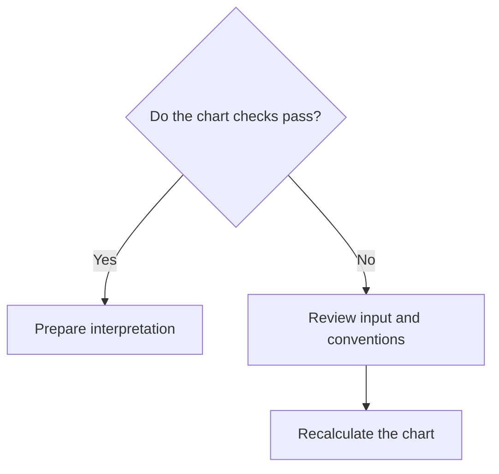

# Report visuals

The chart atlas and Fortune HTML show a D1 house distribution and Vimshottari
timeline. The Fortune PDF includes the house distribution. Both default visuals
use the chart JSON. The D1 bars count plotted bodies with the same denominator
in all 12 houses. The Vimshottari bars use a shared calendar scale with UTC
date labels. The atlas retains precise timestamps in a separate table.

For custom reports, create a JSON specification and run the renderer locally:

```sh
python scripts/report_visuals.py --spec assets/report-visuals.example.json --out reports/visuals.html
```

If the package is installed, use `hermes-report-visuals` with the same arguments.
Open the resulting HTML in a browser. Use the browser's Print dialog to save
the same visuals as an A4 PDF. Files can be opened offline.

| Section type | Required data |
| --- | --- |
| `percentage-bars` | Rows with `label`, numeric `value`, and numeric `maximum`. The maximum must be positive and the value must be within 0 and the maximum. |
| `timeline` | Rows with `label`, `start`, and `end`. Use ISO dates (`YYYY-MM-DD`) and a common timezone. End must follow start. |
| `table` | `columns` and `rows` of matching cell arrays. Optional `numeric_columns` contains zero-based indices for right alignment. |
| `steps` | Rows with a `label` and an optional `detail`, in reading order. |

Every section also requires a `type` and a `title`, and accepts a `note` for
units, source, or calculation basis. The top-level object takes a `title`
and a `sections` array. The complete [example spec](../assets/report-visuals.example.json)
contains all four types.

## Choose the visual

| Need | Visual | Source discipline |
| --- | --- | --- |
| Compatibility points | Percentage bars and exact points table | Read each maximum from the scoring convention. Keep Dasa Porutham statuses separate from Ashtakoota points. |
| D1 distribution | Percentage bars | Count the planets and nodes included in the chart. State the total and plot all houses, including zeros. |
| Dasha sequence | Timeline | Keep UTC dates and the period name. Use calculated start/end boundaries. |
| Positions, settings, or flags | Table | Preserve precision and units. Mark unavailable values explicitly. |
| Chart calculation workflow | Steps or branching diagram | Use steps when every stage runs in sequence. Diagram decisions only if the branches change the outcome. |

For a branching decision in Markdown, use this pattern and keep a prose summary
nearby for viewers without Mermaid:



## Report layout

Use a light background, near-black text, and one purple accent for measured
bars. Use system sans-serif for data, Georgia for headings, and tabular
numerals for exact values. Keep table headers above the data, wrap long
labels, and keep numbers and their units together. Review the report on a
narrow screen and in A4 print preview. Raw counts and scores should remain
visible when printing without background colors.
